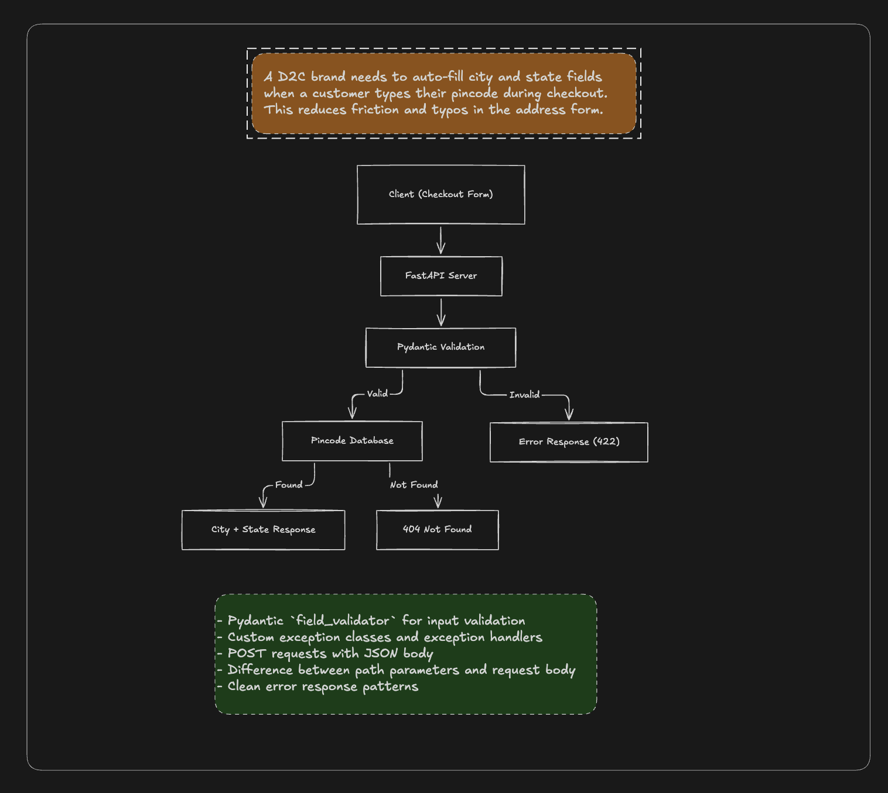

<div align="center">

# 📍 Pincode Lookup API

**Auto-fill City, District & State from an Indian pincode — built for fast, typo-free checkout.**


</div>

---

## 📖 Overview

A D2C brand needs to auto-fill **city** and **state** fields when a customer types their pincode during checkout. This reduces friction and typos in the address form.

**Pincode Lookup API** is a lightweight REST backend that does exactly that. Give it a 6-digit Indian pincode and it returns the matching city, district and state. It also supports **bulk lookups** (up to 20 pincodes per request) and returns clean, consistent error responses.

## ✨ Features

- ⚡ **Fast single lookup** – `GET /pincode/{code}`
- 📦 **Bulk lookup** – `POST /pincode/bulk` (max 20 pincodes per request)
- ✅ **Strict validation** – pincode must be exactly 6 digits (Pydantic validators + route-level checks)
- 🧯 **Custom exception handlers** – structured JSON errors for invalid / missing pincodes
- 📚 **Auto-generated docs** – Swagger UI and ReDoc out of the box
- 🩺 **Health check** endpoint at `/`

## 🛠️ Tech Stack

| Layer | Technology |
| --- | --- |
| Language | Python 3 |
| Framework | FastAPI |
| Validation | Pydantic |
| Server | Uvicorn |
| Data store | In-memory Python dictionary (`data.py`) |
| Tooling | Git, GitHub, VS Code |

## 🗂️ Project Structure

```
Pincode-Lookup-backend/
├── main.py            # FastAPI app, routes & exception handler registration
├── models.py          # Pydantic request/response models and validators
├── exceptions.py      # Custom exceptions + JSON error handlers
├── data.py            # In-memory pincode database
├── ServerDiagram.png  # Architecture / server flow diagram
├── requirements.txt   # Python dependencies
├── .gitignore
└── README.md
```

## 🏗️ Architecture



## 🚀 Getting Started

### Prerequisites

- Python 3.9+
- pip

### Installation

```bash
# 1. Clone the repository
git clone https://github.com/VINAY-160/Pincode-Lookup-backend.git
cd Pincode-Lookup-backend

# 2. Create & activate a virtual environment
python -m venv venv
source venv/bin/activate        # Windows: venv\Scripts\activate

# 3. Install dependencies
pip install -r requirements.txt

# 4. Run the server
uvicorn main:app --reload
```

The API will be live at **http://127.0.0.1:8000**

### Interactive Docs

| Docs | URL |
| --- | --- |
| Swagger UI | http://127.0.0.1:8000/docs |
| ReDoc | http://127.0.0.1:8000/redoc |

## 📡 API Reference

### 1. Health Check

`GET /`

```json
{
  "message": "App Running successfully",
  "status": "Healthy"
}
```

### 2. Single Pincode Lookup

`GET /pincode/{code}`

**Example:** `GET /pincode/110001`

```json
{
  "pincode": "110001",
  "city": "New Delhi",
  "state": "Delhi",
  "district": "Central Delhi"
}
```

### 3. Bulk Pincode Lookup

`POST /pincode/bulk`

**Request body**

```json
{
  "pincodes": ["110001", "400001", "999999"]
}
```

**Response**

```json
{
  "status": "success",
  "found": 2,
  "not_found": 1,
  "results": [
    { "pincode": "110001", "city": "New Delhi", "state": "Delhi", "district": "Central Delhi" },
    { "pincode": "400001", "city": "Mumbai", "state": "Maharashtra", "district": "Mumbai City" }
  ],
  "missing": ["999999"]
}
```

**Rules:** at least 1 and at most 20 pincodes; each must be exactly 6 digits.

## ⚠️ Error Responses

| Status | Error | When |
| --- | --- | --- |
| `400` | `invalid_pincode` | Pincode is not exactly 6 digits |
| `404` | `pincode_not_found` | Valid pincode, but not in the database |
| `422` | Validation error | Bulk request body fails Pydantic validation (empty list, more than 20, bad format) |

**Example – 404**

```json
{
  "error": "pincode_not_found",
  "message": "No location for pincode: 999999",
  "pincode": "999999"
}
```

**Example – 400**

```json
{
  "error": "invalid_pincode",
  "message": "Pincode 12AB is invalid: Must be exactly 6 digit",
  "pincode": "12AB"
}
```

## 🧪 Quick Test (cURL)

```bash
# Single lookup
curl http://127.0.0.1:8000/pincode/560001

# Bulk lookup
curl -X POST http://127.0.0.1:8000/pincode/bulk \
  -H "Content-Type: application/json" \
  -d '{"pincodes": ["110001", "201301", "700001"]}'
```

## 📍 Sample Pincodes Available

The current in-memory dataset covers major cities:

`110001` New Delhi · `400001` Mumbai · `560001` Bangalore · `600001` Chennai · `700001` Kolkata · `500001` Hyderabad · `411001` Pune · `380001` Ahmedabad · `302001` Jaipur · `226001` Lucknow · `682001` Kochi · `440001` Nagpur · `800001` Patna · `160001` Chandigarh · `201301` Noida

## 🔮 Future Improvements

- [ ] Replace the in-memory dict with a database (PostgreSQL / SQLite) holding the full India Post pincode dataset
- [ ] Add caching (Redis) for high-traffic checkouts
- [ ] Rate limiting and API-key authentication
- [ ] Unit tests with `pytest` + CI via GitHub Actions
- [ ] Dockerize the application
- [ ] Deploy (Render / Railway / AWS)

## 🤝 Contributing

Contributions, issues and feature requests are welcome!

1. Fork the repo
2. Create your feature branch: `git checkout -b feature/amazing-feature`
3. Commit your changes: `git commit -m "Add amazing feature"`
4. Push to the branch: `git push origin feature/amazing-feature`
5. Open a Pull Request

## 👤 Author

**Vinay**

- GitHub: [@VINAY-160](https://github.com/VINAY-160)

---

<div align="center">

⭐ If you found this project useful, consider giving it a star!

</div>
